


  

  


 

> I build AI systems that can **reason, use tools, automate tasks, and work together.**

<code>CERTIFICATIONS</code> 

<code>LANGUAGES</code> 

 

<code>AI / GENAI</code> 

 

 

<code>EXPLORING</code> 

 

<code>AUTOMATION / DATA</code> 

 

<code>FRONTEND AND TOOLS</code> 

<table align="center">
<tr>
<td align="center" width="50%">
<a href="https://github.com/ayush-yadav314/autonomous-browser-agent"></a>
 

</td>
<td align="center" width="50%">
<a href="https://financial-agent-ai-a.streamlit.app/"></a>
 

</td>
</tr>
<tr>
<td align="center" width="50%">
<a href="https://platelog-alpha.vercel.app"></a>
 

</td>
<td align="center" width="50%">
<a href="https://ai-cyberverse.vercel.app"></a>
 

</td>
</tr>
</table>

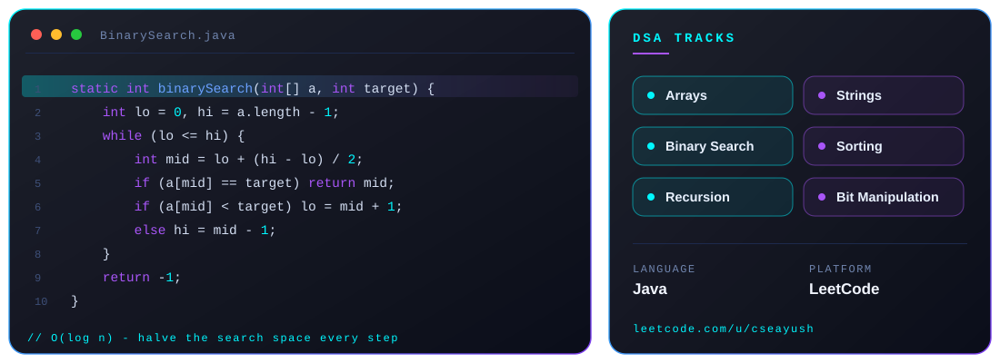

 

 

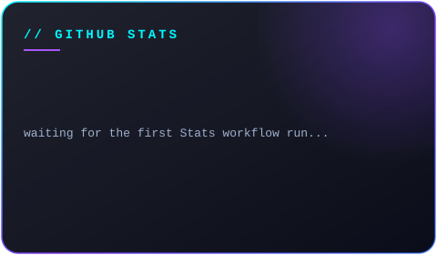
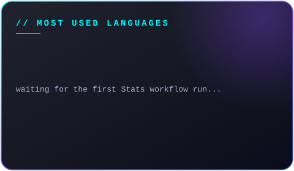

 

 


 

 


 

  

  

